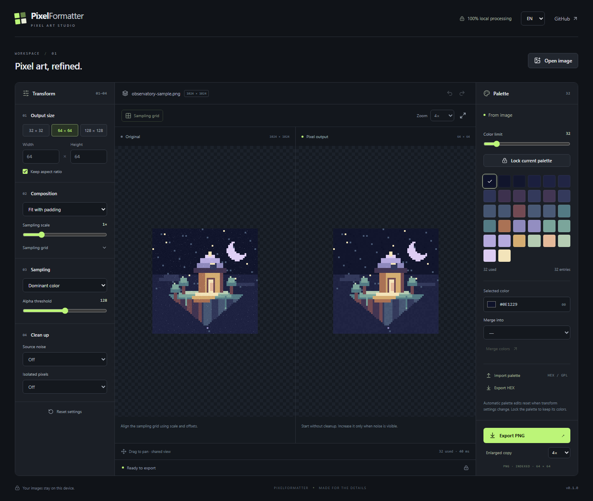

<div align="center">

# PixelFormatter

**Pixel art, refined.**

Turn pixel-like images into a clean grid with a deliberate palette.
Tune, compare, and export a real indexed PNG — entirely on your device.

[](https://github.com/T4rnum/PixelFormatter/actions/workflows/ci.yml)
[](LICENSE)


[Getting started](#getting-started) · [How it works](#how-it-works) · [Architecture](docs/ARCHITECTURE.md) · [Contributing](CONTRIBUTING.md)



</div>

## Why PixelFormatter?

AI-generated “pixel art” often contains uneven blocks, extra shades, and stray pixels. Simply resizing it can select noise or blend edges. PixelFormatter gives you control over the sampling grid, color budget, and cleanup, with an immediate visual comparison.

It is a refinement tool, not a generative model or a replacement for an artist. It guarantees a regular output grid, bounded palette, and lossless indexed export. Artistic quality still requires judgment; small intended details can resemble noise.

## Features

- **Precise output:** presets or custom dimensions from 1 to 512 pixels per axis; aspect lock, fit/padding, crop, sampling scale, and offsets.
- **Three sampling methods:** dominant color, nearest neighbor, and area average.
- **Optional cleanup:** source median filter and conservative isolated-pixel cleanup, both off by default.
- **Palette control:** weighted median cut, perceptual OKLab mapping, 1–255 visible colors, direct editing, merging, and palette locking.
- **Palette files:** import GIMP `.gpl` or six-digit RGB `.hex`/`.txt`; export HEX.
- **Pixel-accurate comparison:** synchronized pan, integer zoom including 1:1, sampling grid, and transparency checkerboard.
- **Real indexed PNG:** up to 255 opaque colors plus one transparent entry; export at native size or 2×/4×/8×/16× without smoothing.
- **Reversible editing:** 50-step undo/redo, reset, and immutable source pixels.
- **Private by design:** no uploads, accounts, analytics, external fonts, or model downloads. RU/EN interface.

## Before / after

Original procedural artwork and deterministic noise are generated by this project. No third-party artwork is included.

| Noisy 1024 × 1024 source                         | Nearest-neighbor baseline                                    | Dominant-color result                               |
| ------------------------------------------------ | ------------------------------------------------------------ | --------------------------------------------------- |
|  |  |  |

Both outputs are 64 × 64 with 32 colors, shown as 4× indexed PNG copies. Cleanup is disabled to isolate the sampling comparison. These examples demonstrate the workflow; they do not establish quality on arbitrary generated images.

## Getting started

Use **Node.js 22 LTS or newer** and npm. Node 20.18.1 was also used for local validation.

```sh
git clone https://github.com/T4rnum/PixelFormatter.git
cd PixelFormatter
npm ci
npm run dev
```

Open the localhost URL printed by Vite. Click **Try sample** or open a PNG, JPEG, or WebP. No API keys or environment variables are needed.

```sh
npm run build
npm run preview
```

The production output is a static `dist/` directory. Serve it over HTTP; opening `index.html` directly as a file will not support the worker. Public hosting is intentionally outside the first implementation.

## A good starting workflow

1. Open an image and choose the target size (default: 64 × 64).
2. Turn on **Sampling grid**. Adjust scale and offsets if the source blocks do not align.
3. Compare **Dominant color** with **Nearest neighbor**. Start with cleanup disabled.
4. Set the color limit (default: 32), edit or merge colors, or import a palette.
5. **Lock current palette** before changing transforms if you want to retain your edited colors.
6. Add gentle cleanup only where needed. Inspect thin contours at an integer zoom.
7. Export PNG once the status says **Ready to export**.

The original pane is displayed in the same sampling coordinate system as the result. Zoom 1× means one output pixel per screen CSS pixel; the original is scaled to the corresponding field of view. Drag either pane to pan both.

**Keyboard:** Ctrl/Cmd+Z undoes; Ctrl/Cmd+Shift+Z redoes. Native text-field undo is preserved while editing an input.

### Palette and alpha behavior

Automatic palette edits reset when processing settings change. Locking turns the edited palette into a fixed palette; subsequent changes preserve those colors. A fixed palette uses its own size, so the automatic color-limit slider is disabled.

Changing a swatch replaces that palette entry without reassigning pixels. Merging redirects indices; unused entries remain in the PNG palette to keep editing indices stable. “Used” reports distinct visible RGB colors actually present, while “entries” includes unused entries and transparency.

Transparency is binary: source alpha below the threshold becomes transparent. For area-based sampling, a cell is opaque when at least half its area has opaque source coverage. Outside-image padding is transparent. Transparent RGB values do not contaminate sampled colors. Partially transparent output is not supported in v0.1.

HEX palettes contain one `RRGGBB` or `#RRGGBB` value per line. Blank lines and `//` comments are accepted. Duplicate colors are removed. Invalid or oversized palettes are rejected rather than silently truncated.

## How it works

```text
Image → orientation-aware decode → optional median filter
      → sampling geometry → downsampling → palette / OKLab mapping
      → isolated-pixel cleanup → indices + palette → preview / PNG
```

The processing core is framework-independent TypeScript. A Web Worker performs processing and PNG encoding, while React handles controls and canvas display. Preview and export share the same indexed image; exporting never quantizes it again.

Read [architecture and algorithm decisions](docs/ARCHITECTURE.md) for geometry, caching, request ordering, and PNG encoding details.

## Development and validation

```sh
npm run typecheck
npm run format:check
npm test
npx playwright install chromium
npm run test:e2e
npm run benchmark
```

- Vitest covers geometry, transparency, sampling, filtering, palette limits, edits, and independent PNG decoding with `pngjs`.
- Playwright covers file upload, external palettes, merging, undo/redo, native PNG downloads, rapid settings/source changes, localization, and a narrow layout.
- `npm run fixtures` regenerates the original example set: aligned art, noise, shifted grid, gradients, and thin contours.
- GitHub Actions runs type checking, unit tests, production build, and Chromium scenarios.

See [validation and measured performance](docs/VALIDATION.md). Checks use deterministic fixtures; evaluation on the project owner's actual generated images remains a pre-release acceptance task.

## Limits and roadmap

v0.1 is a working preview for desktop browsers: one image at a time, up to 16 million decoded pixels and 50 MB per source file. Decoding occurs before the pixel limit can be checked, so very large compressed images can briefly consume substantial memory. The original canvas and worker each retain source pixels. Heavy cleanup on maximum-size inputs takes longer than the 1024 × 1024 benchmark.

The app uses the browser's image decoder and color handling; cross-browser source decoding may differ slightly. Current automated browser coverage targets Chromium. For animated formats, only the browser-decoded frame is processed; animation export is not supported.

No brush editor, batch jobs, automatic recovery of irregular grids, project-file persistence, or public hosted demo is included. Reloading clears the image and edits; only the language preference is stored locally.

Next milestones: evaluate real generated inputs, improve sampling from that evidence, expand browser coverage, then publish a demo and first stable release.

## License

[MIT](LICENSE). Bundled procedural artwork and fixtures are included under the same license. Dependency licenses remain with their respective authors.
